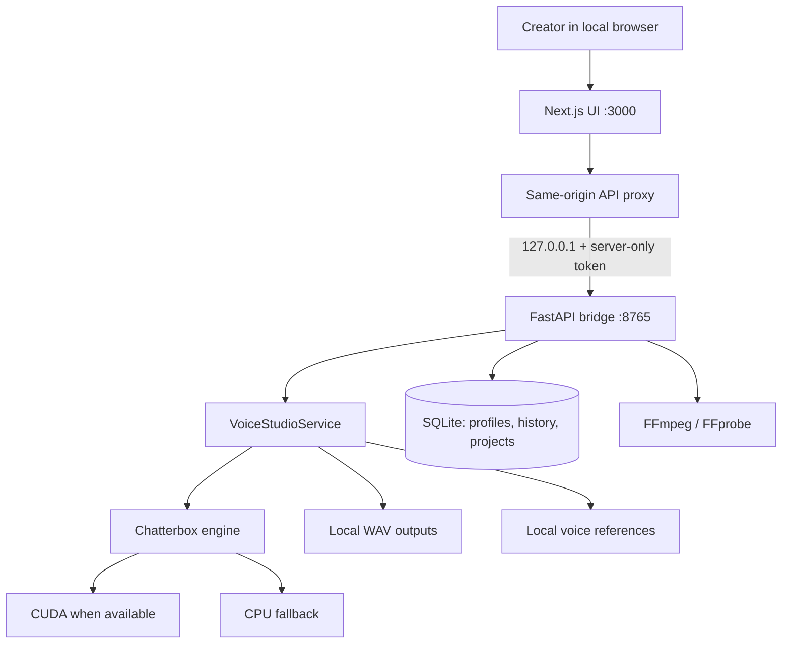

# ArkByte Voice Studio — Web Edition 1.2.0

**A local-first AI narration workspace for creators.** Import recordings you own or are authorized to use, create reusable voice profiles, write and save narration projects, generate speech with a local Chatterbox engine, and manage your audio history — without paid speech APIs, subscriptions, usage credits, or a hosted database.

> **Scope:** This repository is a single-user local application. The Next.js UI binds to `127.0.0.1:3000`; the FastAPI bridge binds to `127.0.0.1:8765`. It is not a public multi-tenant SaaS deployment and must not be exposed to a LAN or the internet without a separate security redesign.

## Product overview

ArkByte Voice Studio is designed for creators who already have recordings and want to produce future narration without recording each script from scratch. A voice profile is created from a short reference segment extracted from an imported video or audio file. The local TTS engine uses that reference when generating a narration.

### Current capabilities

- **Creator dashboard:** live local-service health, voice/profile counts, saved-project count, recent generations and readiness indicators.
- **Voice library:** retain the original audio/video source and create a reusable reference profile. Legacy one-reference profiles remain supported.
- **Voice Lab (new):** enrol up to ten recordings per voice profile, add recordings later, retain original media, create separate non-denoised 24 kHz references, inspect acoustic quality metrics, and choose the reference anchor manually.
- **Voice intelligence pipeline:** show consent, quality-analysis, transcript-review, optional speaker-identity, speaker-confirmed accent, basic prosody and reference-selection status without marking missing stages as complete.
- **Optional local transcription:** use Faster-Whisper to draft transcripts, then manually review and save each one before training export. Model weights are fetched only on first use.
- **Personal pronunciation dictionary:** map names, acronyms and difficult written terms to speaker-confirmed spoken forms before generation.
- **Benchmark Studio:** A/B playback of the active reference and saved output, acoustic proxy comparisons, and optional ECAPA-TDNN speaker-embedding comparison when SpeechBrain and its pretrained weights are available.
- **Qwen3-TTS dataset export:** export full source utterances, user-reviewed transcripts and a shared reference in the official single-speaker training-data JSONL layout. Model fine-tuning remains a separate opt-in workflow.
- **Optional VoxCPM 2 adapter:** an isolated, lazy-loaded generation adapter using reference-only or transcript-conditioned reference cloning. It is not installed by the base installer.
- **Consent guard:** profile creation requires the user to confirm that they own the voice or have explicit permission from the speaker.
- **Script Studio:** up to 50,000 characters, language selection, output filename, expression/CFG/temperature controls, script duration estimate and generation progress.
- **Persistent Projects library:** save and reopen scripts together with voice choice, language, output name and generation settings. Projects are stored in SQLite, not only in browser storage. Project lists return compact summaries; full scripts are fetched only when a project is opened.
- **Generation queue:** one local generation worker prevents concurrent model jobs from competing for GPU memory. Job status is polled by the browser.
- **Generation history:** review completed narrations, preview local WAV output and download it.
- **System health:** verify Python service, database integrity, Chatterbox/PyTorch availability, CUDA availability, FFmpeg and FFprobe.
- **Local-first privacy:** no mandatory account, hosted database, paid API key or cloud inference endpoint.
- **Windows setup scripts:** prerequisite detection, isolated Python environment, optional AI dependency installation, generated local bridge credentials, diagnostics, start/stop and production build scripts.

### Explicitly not included in this release

This release does not claim to provide a multitrack DAW, automatic speaker diarization, automatic music separation, verified ASR transcripts without user review, phoneme alignment, automatic accent classification, learned speaker-specific prosody adaptation, in-app Qwen3-TTS inference/fine-tuning, subtitle generation, YouTube publishing, multi-user accounts, cloud synchronization, or a public SaaS control plane. The built-in quality metrics and ECAPA cosine similarity are diagnostic signals, not proof of exact voice identity or accent fidelity.

## Technology stack

| Layer | Technology | Responsibility |
|---|---|---|
| Web UI | Next.js 16.4.3, React 19.3.1, TypeScript | Local creator workspace and server-side API proxy |
| UI styling | Custom CSS, responsive layout, CSS motion, Lucide icons | Branded dark interface, accessibility and reduced-motion support |
| Local API | Python 3.12/3.13, FastAPI, Uvicorn, Pydantic | Validation, local authentication, jobs and media operations |
| Persistence | SQLite (WAL, busy timeout, bound SQL parameters) | Profiles, history and saved narration projects |
| Voice engines | Chatterbox Multilingual V3; optional VoxCPM 2 adapter | Local reference-conditioned speech generation |
| Voice identity evaluation | Optional SpeechBrain ECAPA-TDNN | Speaker embeddings and cosine comparison; optional pretrained weights |
| Adaptation data | Qwen3-TTS single-speaker JSONL export | Training dataset generation; training is performed separately |
| Media processing | FFmpeg / FFprobe | Extract and prepare reference audio |
| Runtime | Local CPU or compatible CUDA GPU | Inference without a paid API |

The versions in `web/package.json` are pinned at the top level. Next.js 16.4.3 and React 19.3.1 are stable releases at the time this release was prepared; use supported LTS Node.js (22 LTS recommended). See the [Next.js release information](https://www.npmjs.com/package/next) and [React versions](https://react.dev/versions).

## Architecture



### Request flow

1. The browser sends a same-origin request to `/api/...`.
2. The Next.js route handler validates the path against an explicit endpoint allowlist and checks the request origin for browser mutations.
3. The proxy reads `ARKBYTE_BRIDGE_TOKEN` server-side. The secret is never exposed to client JavaScript.
4. The proxy forwards the request to `ARKBYTE_BRIDGE_URL`, defaulting to `http://127.0.0.1:8765`.
5. FastAPI checks that the request came from loopback and compares the token using constant-time comparison.
6. The service validates inputs, stores metadata in SQLite and calls the local media/voice engine.
7. Generated output is written atomically to the local output directory; the history table stores a reference to that file.

### Local data layout

Default Windows data root: `%LOCALAPPDATA%\ArkByte Voice Studio`.

```text
ArkByte Voice Studio/
├── arkbyte_voice_studio.db
├── profiles/<profile-id>/
│   ├── samples/       # Original enrolment recordings
│   └── references/    # Separate 24 kHz model-ready references
├── imports/                 # temporary imports; removed after profile creation
├── outputs/<generated>.wav
├── logs/application.log
├── cache/huggingface/       # downloaded model assets (HF_HOME)
├── cache/torch/             # local PyTorch cache (TORCH_HOME)
└── temp/
```

On Linux/macOS, the data root follows XDG/macOS application-support conventions. Set `ARKBYTE_VOICE_HOME` to use a custom location. Keep this directory private: it contains voice references, scripts/projects metadata and generated audio.

## Quick start — Windows 10/11 x64

### Requirements

- Windows 10/11 x64.
- Node.js 22 LTS recommended (Next.js 16 requires Node.js 20.9 or newer; `.nvmrc` selects 22).
- Python 3.12 recommended; 3.13 is also supported by the local service. `.python-version` selects 3.12.
- FFmpeg and FFprobe. The Windows installer detects them and attempts to install the Gyan FFmpeg package through WinGet when missing.
- Internet access during dependency installation and the first model-weight download.
- At least 8 GB free for base setup. The Windows installer requires 15 GB free when `-InstallAI` is requested; allow additional space for the first model-weight download. Actual model storage varies by model/build.
- Compatible hardware. CPU mode is supported by the engine, but generation may be slow. CUDA requires a compatible NVIDIA driver and PyTorch build.

### Install

1. Download the source ZIP.
2. Before extraction, right-click the ZIP → **Properties** → General → select **Unblock** if Windows displays it under Security → Apply → OK. Do not disable SmartScreen or Microsoft Defender.
3. Extract the ZIP to a writable folder, e.g. `C:\Users\<you>\ArkByte Voice Studio Web`.
4. Open PowerShell in the extracted folder (File Explorer address bar → type `powershell`).
5. Install the web and local service dependencies:

   ```powershell
   Set-ExecutionPolicy -Scope Process Bypass -Force
   .\INSTALL_WEB_WINDOWS.ps1
   ```

6. Install the local AI packages when ready:

   ```powershell
   .\INSTALL_WEB_WINDOWS.ps1 -InstallAI
   ```

   The installer creates a dedicated web-only `.venv` inside this repository. It does not modify the desktop application's Python environment. It detects or attempts to install Node.js, Python and FFmpeg/FFprobe using WinGet; if WinGet is unavailable, the error message gives the manual download location. The web edition shares the default ArkByte creator-data directory (`%LOCALAPPDATA%\ArkByte Voice Studio`) with the desktop app. The local bridge token is generated in `web/.env.local` and must not be committed. `-ForceNewEnvironment` preserves the previous web virtual environment as a timestamped backup before recreating it.
7. Start the app by double-clicking `START ARKBYTE VOICE STUDIO WEB.cmd`, or run:

   ```powershell
   .\START ARKBYTE VOICE STUDIO WEB.ps1
   ```

8. Open `http://127.0.0.1:3000`. Stop the services with `STOP ARKBYTE VOICE STUDIO WEB.cmd`.

### Production build

```powershell
.\BUILD ARKBYTE VOICE STUDIO WEB.cmd
.\START ARKBYTE VOICE STUDIO WEB.ps1 -Production
```

The production process still listens on loopback. Do not use a public reverse proxy or expose ports 3000/8765 without designing remote authentication, per-user data isolation and a different threat model.

## Voice Lab and manual speaker testing

Read [`docs/VOICE_INTELLIGENCE.md`](docs/VOICE_INTELLIGENCE.md) for the feature boundaries and [`docs/MANUAL_VOICE_TESTING.md`](docs/MANUAL_VOICE_TESTING.md) for the ten-recording protocol, held-out test script, A/B evaluation and Qwen dataset export. Recordings and exported datasets contain biometric voice data and must remain private.

## Optional models

- VoxCPM 2 is an optional adapter. Review `service/requirements-voxcpm.txt` and `docs/MODEL_ADAPTERS.md` before installing it in a cloned environment.
- ECAPA speaker-embedding comparison is optional. Review `service/requirements-speaker-id.txt`; verify matching PyTorch/torchaudio versions before installing SpeechBrain. The model weights download on first explicit use.
- Local transcript drafting is optional. Install `service/requirements-transcription.txt`; Faster-Whisper model weights download on first use. Review every transcript and click Save transcript before exporting a Qwen training dataset.
  ```powershell
  .\.venv\Scripts\python.exe -m pip install -r service\requirements-transcription.txt
  ```
- Qwen3-TTS export is included, but Qwen training and inference are external to this app release. See the generated training ZIP and official fine-tuning instructions.

## Local development

### Python bridge

From the repository root (Python 3.12/3.13 recommended):

```powershell
py -3.12 -m venv .venv
.\.venv\Scripts\python.exe -m pip install -r service/requirements.txt
$env:PYTHONPATH = "$PWD\service"
$env:ARKBYTE_BRIDGE_TOKEN = "replace-with-a-local-random-secret"
$env:ARKBYTE_VOICE_HOME = "$env:LOCALAPPDATA\ArkByte Voice Studio"
.\.venv\Scripts\python.exe -m uvicorn main:app --app-dir service --host 127.0.0.1 --port 8765
```

To install AI packages in that same environment:

```powershell
.\.venv\Scripts\python.exe -m pip install -r service/requirements-ai.txt
```

### Next.js frontend

In a separate terminal, create the frontend environment file from the committed example:

```powershell
cd web
Copy-Item .env.example .env.local
# Generate a strong random token and set the SAME value in both the Next.js
# .env.local file and the FastAPI process environment. Never commit that token.
npm install
npm run dev
```

The release includes `web/package-lock.json`; use `npm ci` for a repeatable frontend dependency install. Update and commit the lockfile only when intentionally changing frontend dependencies.

The Next.js API proxy reads the bridge token only on the server. Never prefix it with `NEXT_PUBLIC_`.


### Linux / macOS manual setup

The automated bootstrap scripts in this repository target Windows. On Linux/macOS, install Python 3.12 or 3.13, Node.js 22 LTS, FFmpeg and FFprobe using your operating-system package manager, then run the services manually:

```bash
# From the repository root
python3.12 -m venv .venv
. .venv/bin/activate
python -m pip install --upgrade pip wheel
python -m pip install -r service/requirements.txt
# Optional local AI stack (can require several GB):
python -m pip install -r service/requirements-ai.txt

export PYTHONPATH="$PWD/service"
export ARKBYTE_VOICE_HOME="${XDG_DATA_HOME:-$HOME/.local/share}/ArkByte Voice Studio"
export HF_HOME="$ARKBYTE_VOICE_HOME/cache/huggingface"
export TORCH_HOME="$ARKBYTE_VOICE_HOME/cache/torch"
export HF_HUB_DISABLE_TELEMETRY=1
export ARKBYTE_BRIDGE_TOKEN="$(python -c 'import secrets; print(secrets.token_hex(32))')"
export ARKBYTE_BRIDGE_URL="http://127.0.0.1:8765"
python -m uvicorn main:app --app-dir service --host 127.0.0.1 --port 8765
```

In a second terminal, create `web/.env.local` with the exact same `ARKBYTE_BRIDGE_TOKEN` and `ARKBYTE_BRIDGE_URL`, then start Next.js:

```bash
cd web
npm install
npm run dev
```

Open `http://127.0.0.1:3000`. Keep both processes bound to loopback. These manual commands are for local development; no cross-platform one-click installer is included in this release.

## Configuration

| Variable | Default | Purpose |
|---|---|---|
| `ARKBYTE_BRIDGE_TOKEN` | Generated by installer | Shared secret between Next.js server and local FastAPI bridge |
| `ARKBYTE_BRIDGE_URL` | `http://127.0.0.1:8765` | Local backend URL. Keep loopback-only. |
| `ARKBYTE_VOICE_HOME` | OS-specific ArkByte app-data directory | Creator data root for profiles, projects, database and audio |
| `PYTHONPATH` | Set by launcher | Must include the `service` directory |
| `HF_HOME` | `%LOCALAPPDATA%\ArkByte Voice Studio\cache\huggingface` | Keeps Hugging Face model downloads inside ArkByte's local data root |
| `TORCH_HOME` | `%LOCALAPPDATA%\ArkByte Voice Studio\cache\torch` | Keeps PyTorch cache inside ArkByte's local data root |
| `HF_HUB_DISABLE_TELEMETRY` | `1` in launcher | Disables Hugging Face Hub telemetry |
| `NEXT_TELEMETRY_DISABLED` | Set by launcher | Disables Next.js telemetry in the bundled local workflow |

`.env.example` is safe to commit; `.env.local`, tokens, local databases and creator media are not.

## API surface

All backend endpoints require the private bridge token and accept loopback clients only. In the browser, use the same-origin Next.js `/api` proxy.

| Method | Endpoint | Purpose |
|---|---|---|
| GET | `/api/v1/health` | Engine, GPU, media and database readiness |
| GET | `/api/v1/profiles` | List voice profiles without exposing disk paths |
| POST | `/api/v1/enrollments` | Enrol 1–10 recordings into a reusable voice profile |
| GET | `/api/v1/profiles/{id}/detail` | Read sample diagnostics, transcripts, pipeline status and pronunciation entries |
| POST | `/api/v1/profiles/{id}/samples` | Add recordings to an existing profile (up to ten total) |
| POST | `/api/v1/profiles/{id}/samples/{sample-id}/transcribe` | Optional Faster-Whisper local draft transcript |
| PUT | `/api/v1/profiles/{id}/samples/{sample-id}/transcript` | Review and save/correct an exact sample transcript |
| POST | `/api/v1/profiles/{id}/anchor/{sample-id}` | Select the active reference audio anchor |
| GET | `/api/v1/profiles/{id}/training-export/qwen3` | Export a Qwen3-TTS dataset ZIP after all transcripts are reviewed |
| GET/POST/DELETE | `/api/v1/profiles/{id}/pronunciations` | Manage personal pronunciation substitutions |
| GET | `/api/v1/models` | Read generation, transcription and optional identity-evaluation model status |
| POST | `/api/v1/benchmarks/{history-id}` | Compare generated audio to profile acoustic medians |
| POST | `/api/v1/benchmarks/{history-id}/speaker-identity` | Optional ECAPA-TDNN embedding comparison |
| POST | `/api/v1/profiles` | Stream an authorized audio/video file and create a reference profile |
| DELETE | `/api/v1/profiles/{id}` | Delete a voice profile and its reference file; related project reference is cleared |
| GET | `/api/v1/projects` | List compact saved-project summaries for the library view |
| GET | `/api/v1/projects/{id}` | Fetch a full saved project when opened |
| POST | `/api/v1/projects` | Create or update a saved project |
| DELETE | `/api/v1/projects/{id}` | Delete project metadata without deleting voice profiles or generated audio |
| POST | `/api/v1/generations` | Queue one local narration job |
| GET | `/api/v1/generations/{id}` | Poll job status and progress |
| GET | `/api/v1/history` | List generated outputs |
| GET | `/api/v1/audio/{history-id}` | Stream or download a WAV file |

The FastAPI OpenAPI docs are intentionally disabled in the local service so no unauthenticated interactive API explorer is exposed by default.

## Security and privacy model

- **Local-only by design:** the supplied launch scripts bind both services to `127.0.0.1`; the FastAPI dependency also rejects non-loopback clients.
- **Server-only secret:** a 32-byte cryptographically random bridge token is generated on install and stored in `web/.env.local`. The API proxy injects it server-side.
- **Request boundary:** Next.js API routes use a strict path allowlist, no-store responses and same-origin checks for browser-originated requests.
- **Validation:** Pydantic limits script size, language identifiers, IDs and generation settings. Uploads use an extension allowlist, random filenames, streamed writes, actual byte counts and a maximum size.
- **Path containment:** file endpoints resolve output paths under the approved data directory; profile IDs are validated before file operations.
- **Database safety:** SQLite queries use bound parameters, WAL mode and a busy timeout. Projects do not contain arbitrary filesystem paths.
- **Model resource protection:** one generation worker avoids concurrent local model loads and VRAM contention. The engine attempts CUDA → CPU fallback on applicable failures.
- **No security bypasses:** the installer does not disable Defender, SmartScreen or execution policy globally, install root certificates, or open firewall ports.
- **Voice consent:** a profile requires explicit confirmation of ownership or speaker permission. Users are responsible for complying with applicable rights, platform policies and law.

### Important deployment boundary

This project is **not** a remote multi-user SaaS. It has no tenant model, no remote user authentication layer and no per-user isolation suitable for public hosting. The bridge token is intended only for a local single-user process boundary. A network deployment needs an independent security review, user identity, per-user authorization, encrypted storage, audit logging, rate limits, secure job ownership and safe GPU scheduling.

## Reliability and recovery

- SQLite migrations create the `projects` table automatically in existing ArkByte databases; existing profiles and history are not dropped.
- Project saves use SQLite upsert and preserve the original `created_at` timestamp while updating `updated_at`.
- Deleting a profile uses `ON DELETE SET NULL` for saved projects, preserving their scripts and settings.
- Import writes are streamed to a random temporary file and cleaned up in `finally` paths.
- Audio is written atomically by the existing engine; partial files are removed on failure.
- Generation is serialized to reduce GPU memory pressure. A service restart can lose an in-memory active job record, but completed history/audio is persisted.
- API errors return a stable `{ ok: false, error: { code, message } }` shape. UI fetch failures have dedicated offline/timeout messages.
- React route-level error and loading boundaries provide recoverable UI states.
- PowerShell launch scripts write logs under the repository `logs/` folder and attempt to stop partially started processes if startup fails.

If the service is offline, start `START ARKBYTE VOICE STUDIO WEB.cmd` and inspect `logs/backend-error.log` / `logs/nextjs-error.log`. The Python application log is at `%LOCALAPPDATA%\ArkByte Voice Studio\logs\application.log` by default. Treat diagnostic logs as private: they may reveal local paths and operational details.

## Testing and quality checks

Backend tests:

```powershell
$env:PYTHONPATH = "$PWD\service"
python -m unittest discover -s service/tests -v
```

Frontend checks:

```powershell
cd web
npm install
npm run typecheck
npm run build
```

The test suite covers configuration and path containment, media validation/extraction, engine output using a mocked local model, database CRUD and foreign-key behavior, multi-recording profiles, transcript review and export guards, local ASR adapter behavior, bridge authentication, project CRUD and detail loading, compact project summaries, API validation and local API behavior. The integration suite may skip external FFmpeg checks when FFmpeg is not installed.

### Current validation status for 1.2.0

- **Python backend:** 46 tests passed in this build environment, including FFmpeg audio analysis, sample/profile storage, anchor selection, transcript review, optional Faster-Whisper draft transcription, Qwen dataset ZIP export, API routes, and mocked optional model adapters.
- **Python syntax:** service modules compile successfully.
- **Frontend syntax:** static TS/TSX transpilation is checked separately; it does not replace a semantic typecheck.
- **Full Next.js semantic typecheck and production build:** not completed here. `npm ci` could not download packages because the npm registry DNS request failed with `EAI_AGAIN`. Run `npm ci`, `npm run typecheck` and `npm run build` on the target Windows PC or another networked machine before treating the frontend as release-verified.
- **Real Chatterbox / VoxCPM / ECAPA inference:** not executed in this build container. Chatterbox needs your installed model weights and target hardware; VoxCPM and ECAPA are optional and must be installed/loaded separately. Manual voice testing is the next acceptance step.
- **Windows installer and startup scripts:** not executed in this Linux build container.
- Two pre-existing FastAPI shutdown-event deprecation warnings remain.

## GitHub: prepare and push

Before publishing, inspect the repo and confirm no `.env.local`, model cache, database, voice recordings, generated audio or private logs are staged.

```powershell
# From the repository root
Get-ChildItem -Force
git status --short
git check-ignore web/.env.local .venv python-runtime.txt logs
git init
git add .
git status --short
git commit -m "Build ArkByte Voice Studio Web 1.2.0"
git branch -M main
git remote add origin https://github.com/<YOUR-ACCOUNT>/arkbyte-voice-studio-web.git
git push -u origin main
```

If the repository already exists, do not run `git init` or replace its remote blindly; inspect `git remote -v` and commit to the intended repository. Never commit credentials, certificates, voice recordings, model files or customer material.

## Interview walkthrough

See [`docs/INTERVIEW GUIDE.md`](docs/INTERVIEW%20GUIDE.md) for a five-minute demo script, architecture trade-offs and sample interview questions. A concise way to explain this project in a technical interview:

1. **Problem:** creators often re-record the same narration voice for each video. Existing recordings can become reusable voice references, provided the speaker authorizes cloning.
2. **Architecture:** a Next.js frontend calls same-origin API routes. Those routes inject a server-only token and proxy to a loopback FastAPI service. The Python layer owns media processing, SQLite persistence and local model execution.
3. **Security trade-off:** the bridge token is not sent to browser JavaScript. Loopback binding, constant-time token comparison, route allowlisting, Pydantic validation and filesystem path containment protect the local process boundary.
4. **Reliability trade-off:** local neural inference is memory-intensive, so jobs are serialized. CUDA is preferred, with CPU fallback where the engine supports recovery. Jobs are process-local; output history is persisted.
5. **Data design:** voice profiles and generated history reuse the existing ArkByte SQLite database. The 1.1 release adds a project table so script text and delivery settings survive browser restarts.
6. **Limitations:** local single-user product, not a public SaaS; a full multitrack audio editor and multi-user authentication are intentionally outside this release.

Useful interview topics: API proxy trust boundaries, file upload streaming, safe path resolution, SQLite WAL and transactions, project upsert semantics, long-running job polling, GPU memory pressure, graceful CPU fallback and honest operational health reporting.

## Roadmap

- Sentence-level regeneration and segment stitching with richer pause/prosody control.
- Phoneme-level alignment and validated pronunciation/accent evaluation.
- WavLM or other additional speaker-embedding evaluations with calibrated, language-aware test protocols.
- Automatic accent/dialect analysis and speaker-specific prosody adaptation, only after validated evaluation.
- Qwen3-TTS checkpoint loading and model lifecycle integration after separate fine-tuning validation.
- Audio waveform editor and multi-track timeline.
- Local LLM script assistance with optional model registry.
- Better progress recovery for jobs after service restart.
- Optional multi-user architecture only after a separate security and tenancy design.

## Licensing

The ArkByte application source is MIT-licensed. Third-party dependencies and downloaded model weights remain under their own licenses. Review the Chatterbox repository and current model-weight terms before redistribution or commercial use. This application does not bundle AI weights in the source ZIP.


### Windows: Python 3.12/3.13 not detected

The installer accepts 64-bit Python 3.12 or 3.13. Find installed interpreters with `py -0p` or `Get-Command python.exe -All`. Then pass the full executable path explicitly:

```powershell
.\INSTALL_WEB_WINDOWS.ps1 -InstallAI -PythonPath "C:\Users\YOUR_USER\AppData\Local\Programs\Python\Python312\python.exe"
```

Replace the example with the actual `python.exe` path reported on your PC. The installer validates its version and architecture before creating the isolated web `.venv`.
