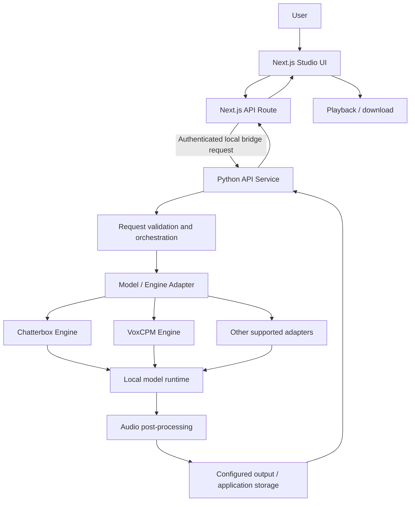
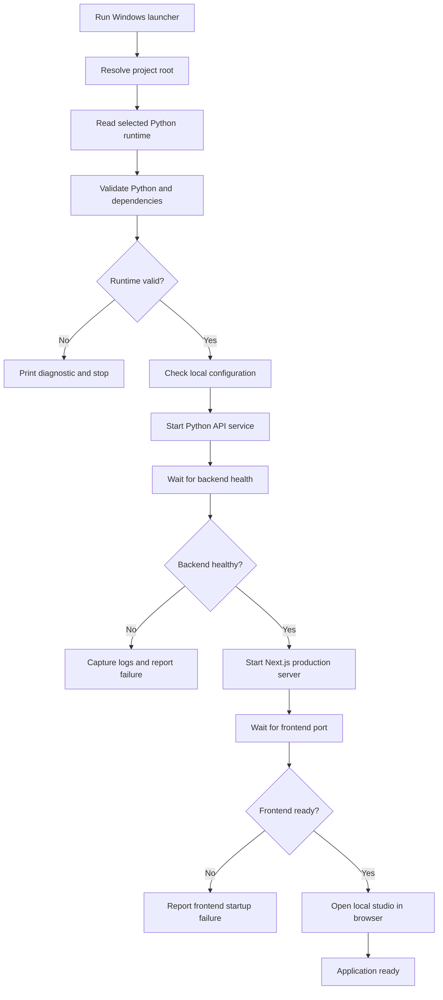
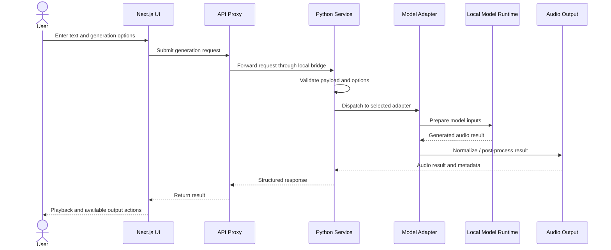
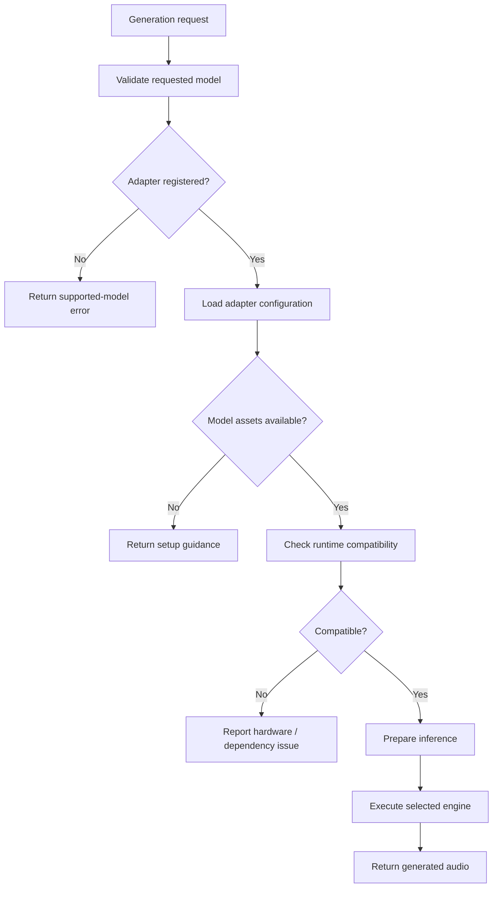
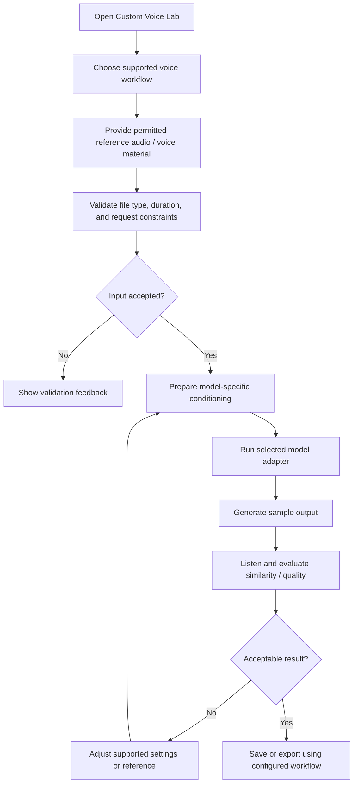
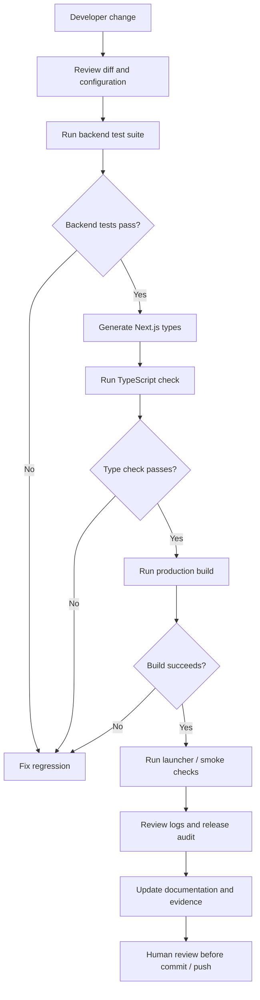

# ArkByte Voice Studio

<p align="center">
  <strong>A local-first AI voice studio for voice generation, reference-guided voice workflows, and model experimentation.</strong>
</p>

<p align="center">
  
  
  
  
  
</p>

ArkByte Voice Studio brings a browser-based studio together with a Python inference service and pluggable speech-model integrations. The application is designed to keep local inference and user-controlled voice assets close to the machine, while exposing a structured interface for model selection, generation, and experimentation.

> **Project status:** Active development. Model quality, supported hardware, and available controls depend on the selected model adapter and local runtime. Do not interpret a successful build or test run as a guarantee of identical output quality across machines.

## Contents

- [Highlights](#highlights)
- [Product walkthrough](#product-walkthrough)
- [Screenshots](#screenshots)
- [Architecture](#architecture)
- [Detailed system flow](#detailed-system-flow)
- [Voice generation lifecycle](#voice-generation-lifecycle)
- [Custom voice workflow](#custom-voice-workflow)
- [Technology stack](#technology-stack)
- [Local setup](#local-setup)
- [Run the application](#run-the-application)
- [Validation and test results](#validation-and-test-results)
- [Repository layout](#repository-layout)
- [Security and responsible use](#security-and-responsible-use)
- [Troubleshooting](#troubleshooting)
- [Documentation](#documentation)
- [Development roadmap](#development-roadmap)

## Highlights

- **Browser-based studio:** a Next.js and TypeScript interface for interacting with the voice service.
- **Python inference service:** a dedicated backend that isolates model execution and audio-processing concerns from the frontend.
- **Model adapter architecture:** model-specific integrations are separated behind adapter/engine boundaries to make experimentation and maintenance easier.
- **Local inference path:** supports a local Python runtime, including a CUDA-enabled environment where compatible hardware and drivers are available.
- **Voice experimentation:** custom voice and reference-audio workflows are organized through the Custom Voice Lab.
- **Operational scripts:** PowerShell and CMD launch, stop, verification, and model-installation helpers support Windows development.
- **Validation-first workflow:** backend tests, TypeScript checks, and a production frontend build are part of the verification process.

## Product walkthrough

[Watch the ArkByte Voice Studio walkthrough](docs/assets/video/ArkByte-Voice-Studio-Walkthrough.mp4)

## Screenshots

The following screenshots showcase the current application interface and workflows.

### Application overview


### Studio and voice workflows

| Voice Lab | Generation History |
|---|---|
|  |  |

| Custom Voice Lab | Script Studio |
|---|---|
|  |  |

### Settings and application management

| Settings and Health | About ArkByte |
|---|---|
|  |  |


### Additional walkthrough captures


## Architecture

The system is split into four primary layers:

1. **Presentation layer** — Next.js pages and React components render the studio and collect user input.
2. **API boundary** — the Next.js API route proxies supported requests to the local Python service and applies the configured bridge boundary.
3. **Application and orchestration layer** — the Python service validates requests, coordinates voice operations, and selects the appropriate engine or adapter.
4. **Inference and asset layer** — model runtimes perform inference; audio and application data are handled by the relevant service/storage components.



### Component responsibilities

| Component | Responsibility |
|---|---|
| `web/` | Next.js application, UI components, frontend types, and API proxy route |
| `service/` | Python API, application services, model engines, storage, and backend tests |
| `docs/` | Setup, architecture, model, security, testing, and release documentation |
| `START*` / `RUN*` scripts | Windows startup entry points |
| `STOP*` scripts | Controlled shutdown of verified ArkByte listeners |
| `VERIFY*` scripts | Runtime and launcher diagnostics |
| `INSTALL*` scripts | Optional model/runtime setup helpers |

The diagram describes the intended request path. Exact adapter availability and optional components depend on the checked-out version and installed model dependencies.

## Detailed system flow

### 1. Application startup and readiness



### 2. Request-to-audio generation



### 3. Model selection and adapter dispatch



### 4. Custom voice and reference-audio workflow



This diagram represents a reference-guided workflow, not a claim that the application trains a foundation model from scratch. Model-specific capabilities vary.

### 5. Validation and release workflow



## Voice generation lifecycle

A typical generation request follows this lifecycle:

1. The user selects a supported model and enters text or other supported inputs.
2. The frontend validates required fields and submits the request through the application API.
3. The backend validates the request again; frontend validation is not treated as a security boundary.
4. The orchestration layer dispatches to the selected engine adapter.
5. The adapter prepares model-specific inputs and invokes the installed inference runtime.
6. The generated audio is returned through the service response path.
7. The frontend presents the result for playback and any supported export action.

## Custom voice workflow

The Custom Voice Lab is intended for controlled experimentation with reference audio and model-supported voice conditioning. Use only audio you own or have explicit permission to use. A reference sample does not guarantee a perfect or 100% identity match; output depends on the source recording, model, language, text, settings, and hardware/runtime.

For detailed model-specific instructions, consult the Custom Voice Lab and model adapter documentation linked below.

## Technology stack

| Layer | Technologies |
|---|---|
| Frontend | Next.js, React, TypeScript |
| Styling and UI | CSS / project UI components |
| Backend | Python, FastAPI-compatible API service |
| Model integration | Model engines and adapter modules |
| ML runtime | PyTorch; optional CUDA runtime where supported |
| Audio | Model-specific audio preprocessing and output handling |
| Local orchestration | PowerShell, CMD, Node.js, npm |
| Quality checks | Python tests, TypeScript compiler, Next.js production build |

## Local setup

### Prerequisites

- Windows 10/11 for the supplied PowerShell/CMD launchers.
- Python 3.12 for the validated local runtime.
- Node.js and npm compatible with the frontend lockfile.
- A supported model runtime and its required model assets.
- NVIDIA driver/CUDA support only if using the CUDA-enabled runtime.
- FFmpeg is optional and is used by the documentation helper to extract screenshots from the walkthrough video.

### Configure the Python runtime

The repository may use a dedicated local virtual environment. The selected interpreter is recorded in `python-runtime.txt` when that file is present. Keep machine-specific interpreter paths local; do not publish local absolute paths or virtual environments.

Example runtime check:

```powershell
Set-Location "C:\Projects\ArkByte Voice Studio Web 1.2.0"
Get-Content .\python-runtime.txt
& (Get-Content .\python-runtime.txt | Select-Object -First 1) --version
```

If the project has a dedicated setup or quickstart guide, follow that guide for dependency installation rather than installing model dependencies into an unrelated global Python environment.

### Configure local secrets

- Start from the tracked example environment files, if present.
- Keep `.env`, `.env.local`, API tokens, bridge tokens, and credentials out of Git.
- Never paste secret values into logs, issue reports, screenshots, or documentation.
- Do not replace an existing bridge token merely to troubleshoot startup; first inspect the relevant error without printing the token.

## Run the application

From the project root, use the supplied launcher:

```powershell
Set-Location "C:\Projects\ArkByte Voice Studio Web 1.2.0"
.\START ARKBYTE VOICE STUDIO WEB.ps1
```

The launcher is expected to verify the configured runtime, start the backend and frontend, and wait for readiness before opening the local studio. Use the exact launcher filename present in your checkout.

To verify listeners:

```powershell
Get-NetTCPConnection -State Listen -ErrorAction SilentlyContinue |
    Where-Object { $_.LocalPort -in 3000,8765 } |
    Select-Object LocalAddress, LocalPort, OwningProcess
```

Use the supplied stop script for shutdown. It checks the project and listener ownership and requires its exact confirmation phrase. Do not terminate processes by PID unless you have independently verified ownership.

## Validation and test results

### Latest recorded local validation

The most recent supplied run reported:

| Check | Result |
|---|---|
| Python runtime | Python 3.12.10 |
| PyTorch | 2.6.0 + CUDA 12.6 build |
| CUDA availability | Available on the test machine |
| GPU | NVIDIA GeForce RTX 3050 Laptop GPU, 6 GB |
| `pip check` | No broken requirements reported |
| Backend tests | **61 tests passed** |
| Frontend TypeScript check | Passed (`next typegen` and `tsc --noEmit`) |
| Next.js production build | Passed |
| Production routes | `/`, `/_not-found`, `/api/[...path]`, `/icon.svg` |

**Known test-runner cleanup warning:** after the backend tests had completed successfully, Python reported a Windows `PermissionError [WinError 32]` while cleaning a temporary test log file that was still open. This did not change the reported result of 61 passing tests, but the temporary log-handle cleanup should be fixed and rechecked.

These are recorded results from one local machine and one run, not a guarantee that every environment will produce the same result. Re-run the checks after code changes and update this section only from fresh logs.

### Suggested repeatable checks

Run the project's existing test and frontend scripts as defined in its configuration. Do not assume optional model weights are present on a clean clone. Record the command, environment, result, and any warning in `docs/reports/validation-report.md` when that report exists.

## Repository layout

```text
ArkByte-Voice-Studio/
├── docs/
│   ├── assets/
│   │   ├── screenshots/
│   │   └── video/
│   ├── reports/
│   └── ...
├── service/
│   ├── arkbyte_voice_studio/
│   ├── tests/
│   └── main.py
├── web/
│   ├── app/
│   ├── components/
│   └── lib/
├── START ARKBYTE VOICE STUDIO WEB.ps1
├── STOP ARKBYTE VOICE STUDIO WEB.ps1
├── VERIFY ARKBYTE RUNNERS.ps1
├── python-runtime.txt
└── README.md
```

This is a high-level guide; optional files and model-specific modules may differ by release. The actual checkout is authoritative.

## Security and responsible use

- Use voice recordings only with the speaker's informed consent or other valid authorization.
- Do not impersonate a person, mislead listeners, commit fraud, or bypass identity/security checks.
- Clearly disclose synthetic or altered audio where context requires it.
- Treat uploaded reference audio, generated audio, model files, logs, and credentials as potentially sensitive.
- Keep secrets and local user data out of source control.
- Review `SECURITY.md` and the safe-use policy before distributing or deploying the application.
- A local-first design does not automatically make every integration private; review the data path of any external service or hosted model.

## Troubleshooting

| Symptom | Checks |
|---|---|
| Backend does not start | Confirm the interpreter path, Python dependencies, model assets, port availability, and `logs/backend.log`. |
| Frontend does not start | Confirm Node/npm versions, installed dependencies, port 3000 availability, and `logs/nextjs.log`. |
| CUDA unavailable | Check NVIDIA driver compatibility, the selected PyTorch build, and the interpreter referenced by the runtime configuration. |
| Model unavailable | Confirm the selected adapter, model dependencies, and required model assets are installed. |
| API bridge error | Check local configuration and bridge setup without printing or sharing secret values. |
| Stop script cancels | Enter the exact confirmation phrase shown by the script; cancellation intentionally leaves processes running. |
| Test cleanup warning | Inspect test teardown and ensure file handles are closed before temporary directories are removed. |

## Documentation

- [quickstart](docs/quickstart.md)
- [ARCHITECTURE](docs/ARCHITECTURE.md)
- [flowcharts](docs/flowcharts.md)
- [CUSTOM VOICE LAB](docs/CUSTOM-VOICE-LAB.md)
- [MODEL ADAPTERS](docs/MODEL_ADAPTERS.md)
- [VOICE INTELLIGENCE](docs/VOICE_INTELLIGENCE.md)
- [SAFE USE POLICY](docs/SAFE-USE-POLICY.md)
- [SECURITY](docs/SECURITY.md)
- [interview guide](docs/interview-guide.md)
- [MANUAL VOICE TESTING](docs/MANUAL_VOICE_TESTING.md)
- [validation report](docs/reports/validation-report.md)
- [repository release audit](docs/reports/repository-release-audit.md)
- [release notes](docs/releases/release-notes.md)
- [repository settings](docs/project/repository-settings.md)

## Development roadmap

- Keep model adapters isolated and document each adapter's supported inputs, dependencies, and limitations.
- Improve automated regression coverage for audio generation, storage, and API validation.
- Resolve the temporary test-log handle cleanup warning and record a clean rerun.
- Maintain reproducible setup instructions for CPU and CUDA environments.
- Keep screenshots, walkthrough video, architecture diagrams, and validation evidence synchronized with the actual release.
- Complete a final repository audit before creating a release or pushing changes.

## Contributing

1. Review the current architecture and relevant documentation before changing a component.
2. Keep secrets, local environments, model weights, generated audio, and private user data out of commits.
3. Add or update tests for behavior changes.
4. Run backend tests, frontend type checking, and a production build.
5. Update documentation and validation evidence to match the verified implementation.
6. Review `git diff` and `git status` before requesting a commit or push.

## License

Add the project's chosen license before presenting this repository as an open-source release. Until a license file and explicit license terms are present, all rights remain with the respective copyright holder.