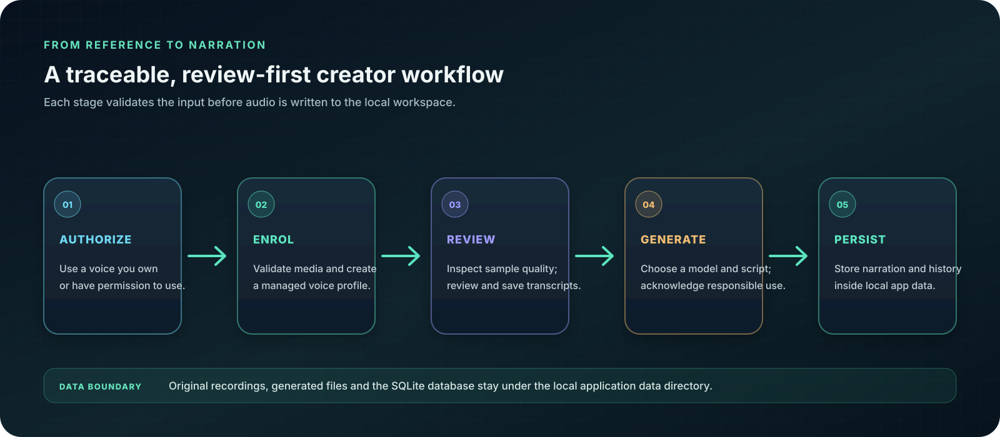
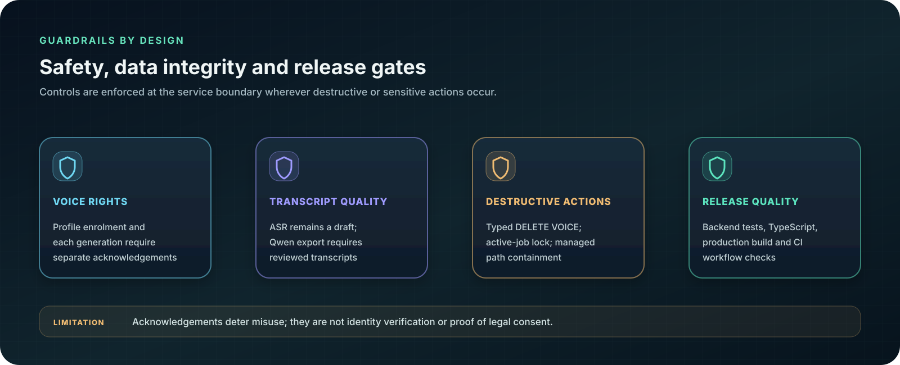
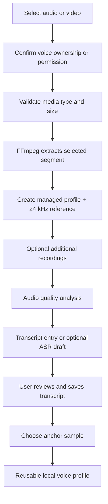
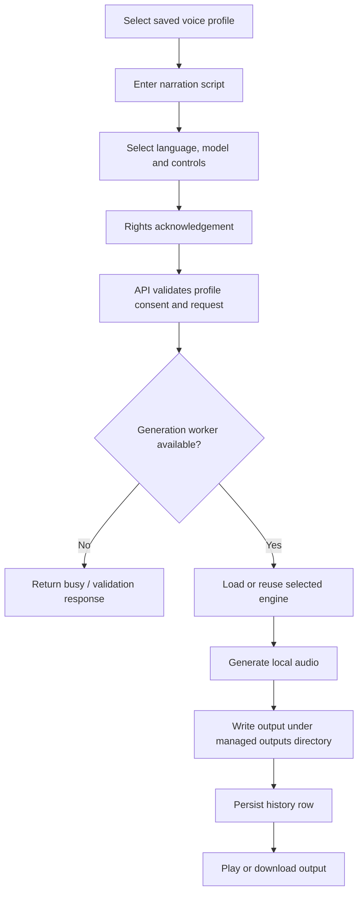
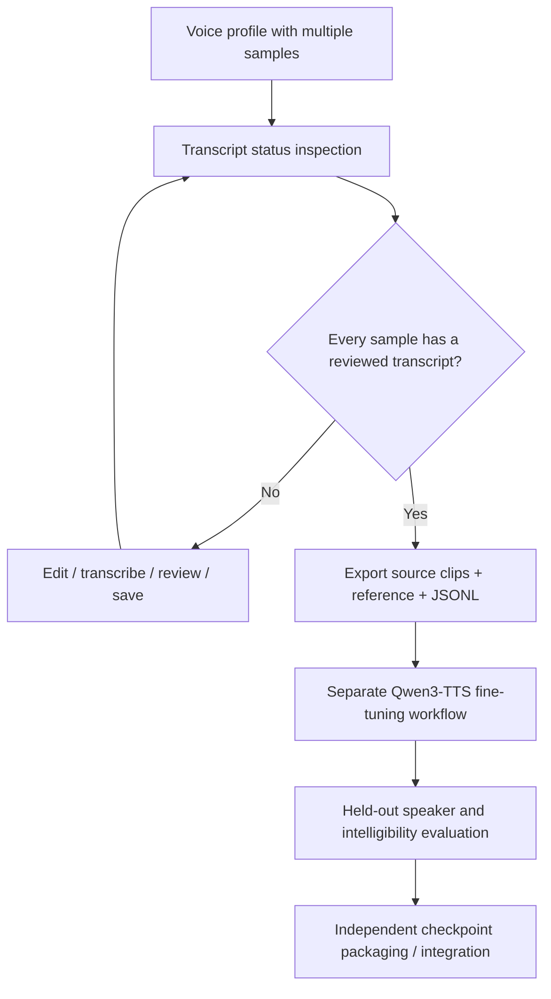
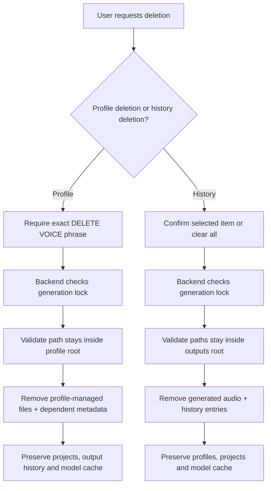

# Workflow diagrams

The SVG summaries below are designed for quick scanning in GitHub; the Mermaid definitions that follow preserve the editable source for each workflow.

---

## Profile enrolment

## Narration generation

## Custom training-data export

The export is the boundary of the current product. Training and custom-checkpoint inference are not yet part of ArkByte 1.2.0.

## Destructive-action safeguards

